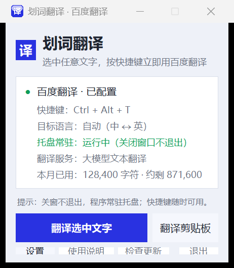
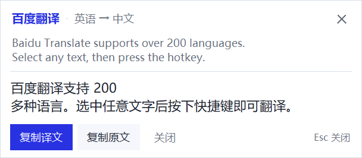
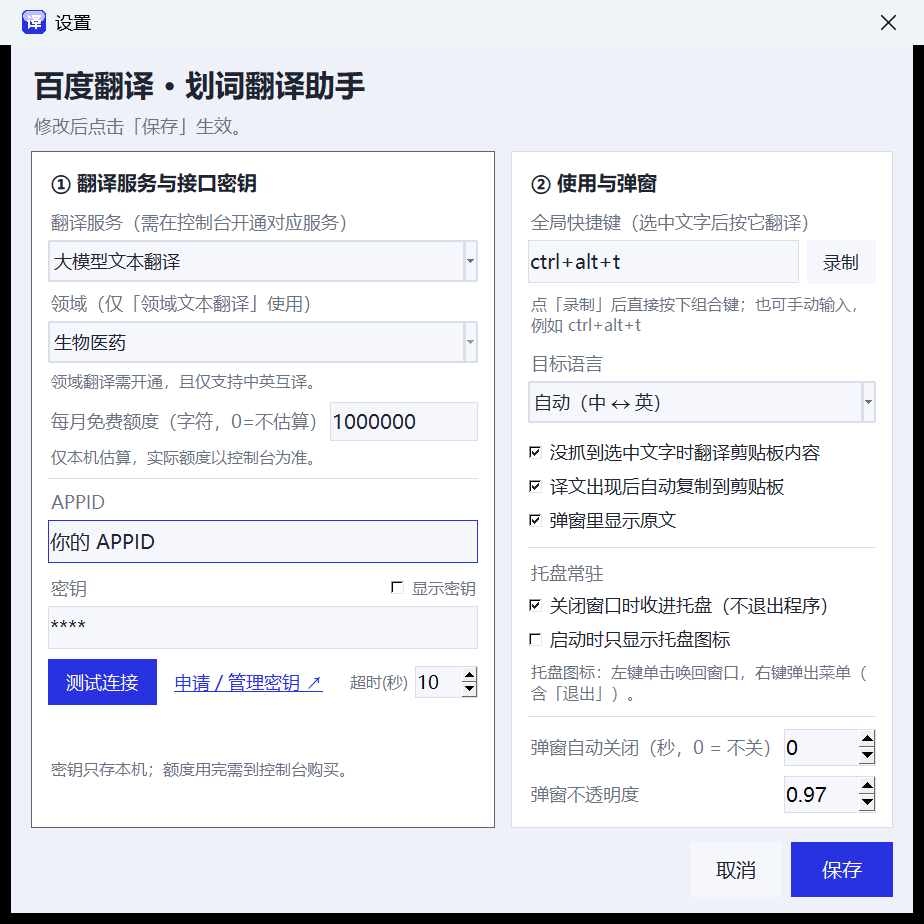
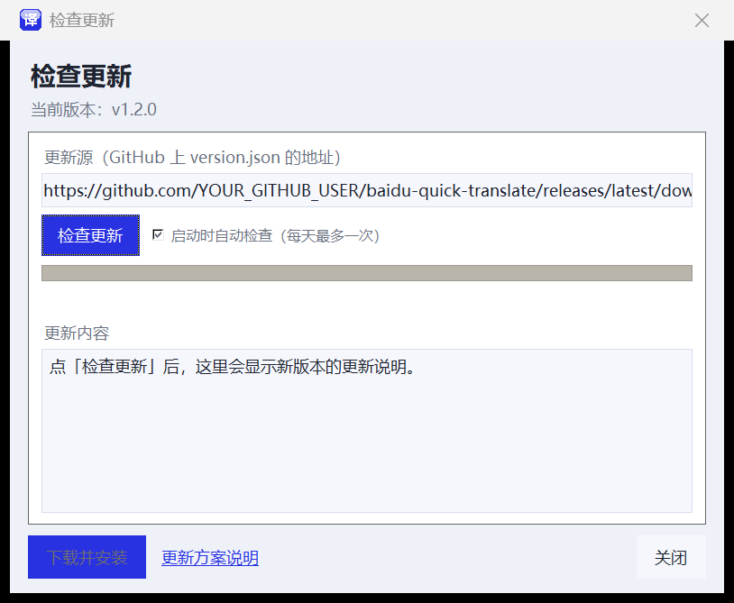

# 划词翻译 · 百度翻译（Windows 小工具）

选中任意程序里的文字，按下快捷键，立即用**百度翻译**翻译，并在鼠标旁弹出一个结果小窗。

- 纯 Python 标准库实现：**不需要安装任何第三方包**（只要 Python 3.9+，Windows 自带 tkinter 即可）
- 全局快捷键取词：在浏览器、Word、记事本、微信、PDF 阅读器里选中文字都能用
- 取词不破坏剪贴板：程序先记住剪贴板原内容，翻译完自动还原
- 结果弹窗：显示原文/译文，可一键复制，Esc 关闭，支持拖动和自动关闭
- **系统托盘常驻**：关窗口只是收进托盘，快捷键随时可用；右键托盘图标有菜单，双击唤回窗口
- **三种翻译服务可切换**：大模型文本翻译 / 通用文本翻译 / 领域文本翻译（11 个垂直领域）
- **额度显示**：主窗口显示「本月已用 X 字符 · 约剩 Y」，按服务和每月免费额度估算
- **自动更新**：从 GitHub Releases 检查新版本、下载、SHA-256 校验并自动替换重启
- 百度官方接口：稳定、准确，各家服务都有每月免费字符额度

> **已经打包好的版本**：`dist\划词翻译\划词翻译.exe`（免安装文件夹版，~12 MB），
> **双击即可运行，不需要安装 Python**；传到别的电脑时把整个 `划词翻译` 文件夹（或 `dist\划词翻译_免安装版.zip`）一起复制。
> 源码版则双击 `run.bat`。两种方式的首次启动都会弹出设置窗口，填入 APPID/密钥即可。







---

## 一、先开通翻译服务并拿到密钥（免费）

> 说明：百度翻译的「网页版接口」现在需要浏览器风控签名，脚本调用会被拦截；
> 正规、稳定的做法是使用百度翻译开放平台的官方 API。个人/企业认证后各家服务每月都有免费字符额度。

1. 打开 <https://api.fanyi.baidu.com/> ，用百度账号登录；
2. 进入「**管理控制台 → 我的服务**」，开通需要的服务（三个都免费额度，可同时开通）：
   - **大模型文本翻译**：译文更自然，支持翻译指令/术语库（本程序默认只做普通文本翻译）
   - **通用文本翻译**：经典接口，支持自动识别源语种
   - **领域文本翻译**：11 个垂直领域，仅支持中英互译
3. 申请通过后，在控制台首页（或「开发者中心 → API Key 管理」）看到 **APPID** 和 **密钥**；
4. 回到本软件「设置」：选择**翻译服务**（领域的话再选**领域**），填 APPID/密钥，点「测试连接」验证，保存。

> 三个服务用的是同一套 APPID + 密钥，只是请求的接口不同；切换服务不用重新申请密钥。

### 三种翻译服务对比

| 服务 | 接口 | 特点 | 本程序里的用法 |
| --- | --- | --- | --- |
| 大模型文本翻译 | `POST https://fanyi-api.baidu.com/ait/api/aiTextTranslate`（Bearer 密钥） | 译文更自然，支持 200+ 语种与翻译指令 | 设置里选「大模型文本翻译」 |
| 通用文本翻译 | `POST https://fanyi-api.baidu.com/api/trans/vip/translate`（md5 签名） | 经典稳定，`auto` 自动识别语种 | 设置里选「通用文本翻译」 |
| 领域文本翻译 | `POST https://fanyi-api.baidu.com/api/trans/vip/fieldtranslate`（签名含领域代码） | 专业术语更准确，仅中英互译 | 设置里选「领域文本翻译」+ 领域 |

领域翻译支持的 11 个领域（设置里的「领域」下拉框）：

| 领域代码 | 领域 | 语言方向 |
| --- | --- | --- |
| academic | 学术论文 | 中 ↔ 英 |
| senimed | 生物医药 | 中 ↔ 英 |
| it | 信息技术 | 中 ↔ 英 |
| finance | 金融财经 | 中 ↔ 英 |
| machinery | 机械制造 | 中 ↔ 英 |
| novel | 网络文学 | 仅中 → 英 |
| news | 新闻资讯 | 中 ↔ 英 |
| wiki | 人文社科 | 仅中 → 英 |
| aerospace | 航空航天 | 中 ↔ 英 |
| law | 法律法规 | 中 ↔ 英 |
| contract | 合同 | 中 ↔ 英 |

---

## 二、快速开始

### 1. 运行程序

**方式 A（推荐，无需 Python）：** 双击 `dist\划词翻译\划词翻译.exe`。
这是「免安装版」，把**整个 `划词翻译` 文件夹**复制到任何 Windows 电脑上都能直接运行
（也可以用 `dist\划词翻译_免安装版.zip` 传递）。

**方式 B（源码运行）：** 电脑上已安装 Python 3.9+ 时，双击 `run.bat`；
或者在命令行里：

```bat
cd /d 本目录
pythonw main.py
```

首次启动会自动弹出设置窗口：先选「翻译服务」，再填 APPID 和密钥 → 「测试连接」→「保存」。

> 也可以直接双击 `main.py`（前提是 .py 已关联到 Python）。
> 建议用 `pythonw` 启动，这样不会留着黑色命令行窗口。

### 2. 开始使用

1. 在任意软件里用鼠标**选中一段文字**；
2. 按快捷键 **`Ctrl + Alt + T`**（可在设置里改）；
3. 鼠标旁边会弹出译文，同时译文已复制到剪贴板，直接 `Ctrl+V` 就能粘贴。

没有选中文字时按下快捷键，会退而翻译**剪贴板里的内容**（可在设置里关掉这个行为）。

### 3. 托盘常驻（重点）

程序默认常驻系统托盘，**点窗口右上角的 ✕ 不会退出**，只是把窗口收进托盘：

| 托盘操作 | 效果 |
| --- | --- |
| 左键单击 / 双击图标 | 唤回主窗口 |
| 右键图标 | 弹出菜单：显示主窗口 / 翻译选中文字 / 翻译剪贴板 / 设置… / 使用说明 / 退出 |
| 菜单里点「退出」 | 真正退出程序（注销全局快捷键、移除托盘图标） |

- 第一次收进托盘时会弹一条系统通知提示；
- 想让它**开机就只待在托盘**：设置里勾选「启动时只显示托盘图标」；
- 想开机自启：把 `划词翻译.exe`（或 `run.bat`）的快捷方式放进
  `%APPDATA%\Microsoft\Windows\Start Menu\Programs\Startup` 即可；
- 托盘图标添加失败时程序会自动重试（每 2 秒，最多 1 分钟）；重试期间关窗口改为最小化到任务栏，
  不会退出，快捷键照常可用；资源管理器重启后也会自动补回图标。

### 4. 主界面上的按钮

| 按钮 | 作用 |
| --- | --- |
| 翻译选中文字 | 等同于按快捷键（如果焦点在本程序窗口上，会改为翻译剪贴板） |
| 翻译剪贴板 | 直接翻译剪贴板里的文字 |
| 设置 | 翻译服务、APPID/密钥、快捷键、目标语言、弹窗、托盘行为等 |
| 使用说明 | 查看配置路径和使用提示 |
| 退出 | 关闭程序并注销全局快捷键（想常驻请点窗口的 ✕） |

### 5. 额度显示（本月已用 / 约剩）

主窗口状态卡里有一行：

```
本月已用：128,400 字符 · 约剩 871,600
```

- **怎么算的**：百度翻译开放平台没有公开「剩余额度查询」接口，所以这是**本机统计**——
  本程序每次成功翻译都会记下原文的字符数，按月、按服务分别累计（保存在
  `%APPDATA%\BaiduQuickTranslate\usage.json`，跨月自动清零）；
  「约剩」= 设置里该服务的「每月免费额度」− 本月已用。
- **注意**：如果同一个 APPID 还在别的软件/电脑上用，实际剩余会比这里少；
  真实用量请以控制台「我的服务」页面为准。
- 额度默认值：大模型 100 万、通用 100 万、领域 50 万字符/月（认证后以百度实际为准），
  可在设置里按当前服务修改；填 0 就只显示已用、不显示剩余。
- 剩余不足 10% 时，这一行会变成橙色提醒。

---

## 三、设置项说明

| 设置项 | 说明 |
| --- | --- |
| APPID / 密钥 | 百度翻译开放平台控制台里的两个值，缺一不可（三个服务共用） |
| 翻译服务 | 大模型文本翻译 / 通用文本翻译 / 领域文本翻译，切换后立即生效 |
| 领域 | 仅「领域文本翻译」使用：学术论文、生物医药、金融财经……共 11 个 |
| 每月免费额度（字符） | 用于估算「约剩多少」。默认：大模型 100 万、通用 100 万、领域 50 万；填 0 则只显示已用不估算 |
| 测试连接 | 用 `hello → 你好` 试翻一条，验证**当前选中的服务**、密钥和网络是否正常 |
| 全局快捷键 | 点「录制」后直接按下组合键，也可以手动输入，例如 `ctrl+alt+t`；至少带一个 Ctrl/Alt/Shift/Win |
| 目标语言 | 默认「自动（中 ↔ 英）」：中文译成英文、其它语言译成中文；也可以固定目标语种 |
| 没抓到选中文字时翻译剪贴板内容 | 部分程序（或选中为空时）拿不到选区，勾上后会用剪贴板兜底 |
| 译文出现后自动复制到剪贴板 | 默认开启，方便直接粘贴 |
| 弹窗里显示原文 | 关掉后弹窗只显示译文，更紧凑 |
| 弹窗自动关闭（秒，0 = 不关） | 例如填 8，弹窗 8 秒后自动消失 |
| 弹窗不透明度 | 0.40 ~ 1.00 |
| 关闭窗口时收进托盘（不退出程序） | 默认开启；关掉后点窗口 ✕ 就直接退出 |
| 启动时只显示托盘图标 | 开机自启时不想弹出主窗口就勾上 |
| 请求超时（秒） | 网络慢时可以调大 |

配置文件位置：`%APPDATA%\BaiduQuickTranslate\config.json`
本机用量统计：`%APPDATA%\BaiduQuickTranslate\usage.json`（按月自动清零）
（想做成便携版：设置环境变量 `BAIDU_QT_HOME=某目录`，配置就保存在该目录下。）

---

## 四、命令行用法

除了图形界面，也可以当命令行翻译工具用（读取同一份配置）：

```bat
python main.py --translate "Hello world"
python main.py --translate "hello" --to zh --from en
python main.py --translate "hello" --service llm          :: 大模型文本翻译
python main.py --translate "hello" --service domain --domain academic   :: 领域：学术论文
python main.py --selftest     :: 本地自检（签名、服务/领域、用量统计、剪贴板、快捷键等）
python main.py --version
```

命令行翻译完成后也会打印本机用量，例如：

```
[通用文本翻译] 英语 → 中文
Hello world
----------------------------------------
你好世界

本月已用：1,234 / 1,000,000 字符（本机统计，约剩 998,766）
```

---

## 五、常见问题

**1. 提示「快捷键 XX 注册失败」**
别的方法已经在用这个组合键（微信、QQ、输入法、显卡驱动都可能占用），到设置里换一个，例如 `ctrl+alt+q`、`ctrl+shift+f2`。

**2. 按了快捷键没反应 / 提示没拿到文字**
- 先确认程序还在运行（托盘里有「译」图标，或任务栏里有窗口）；
- 有些程序（任务管理器、部分 UWP 应用、以管理员身份运行的窗口）不让普通程序发送 Ctrl+C，可以改用「翻译剪贴板」按钮；
- 也可以先把文字复制到剪贴板，再按快捷键（默认会回退翻译剪贴板）。

**2.1 关掉窗口后程序去哪了？**
默认没有退出，只是收进了**系统托盘**（任务栏右下角，可能在「^」里）。
单击托盘里的「译」图标就能把窗口唤回来，右键有「退出」菜单。
想关窗就退出：设置里取消勾选「关闭窗口时收进托盘」。

**2.2 托盘里找不到图标 / 显示「托盘不可用」？**
先点任务栏右下角的「^」（显示隐藏的图标）看看「译」是否在里面；
如果主界面显示「托盘不可用」：
- 程序会**每 2 秒自动重试**添加图标（最多 1 分钟），资源管理器重启后也会自动补回；
- 重试期间**关窗口不会退出**，而是最小化到任务栏，快捷键照常可用；点「退出」才真正退出；
- 如果一直失败，通常是**启动环境受限**（例如从某些沙箱/预览器里打开 exe）。
  请打开「文件资源管理器」，到 `dist\划词翻译\` 目录里**双击 `划词翻译.exe`** 运行。

**3. 接口报错对照**

| 错误码 | 含义与处理 |
| --- | --- |
| 52003 | APPID 未授权：检查 APPID 是否填错，控制台是否**开通了当前选中的服务**（大模型/通用/领域是三个独立服务） |
| 54001 | 通用/领域：签名错误，检查密钥是否配套；大模型：`invalid token` = 密钥不对，或「大模型文本翻译」服务未开通/未认证 |
| 54003 | 访问频率受限：请求太频繁，等几秒再试 |
| 54004 | 账户余额不足：免费额度用完，需在控制台查看/购买 |
| 58001 | 语言方向不支持：领域翻译只支持中英互译，换服务或换语言 |
| 58002 | 服务已关闭：到控制台重新开启对应服务 |
| 90107 | 认证未通过：到控制台完成个人认证 |

> 提示：切换服务后如果报 52003/54001，先在设置里点「测试连接」确认当前服务是否已开通、密钥是否正确。

**4. 高分屏下字体模糊？**
程序启动时已开启 DPI 感知，Windows 缩放 125%/150% 下界面应保持清晰。

**5. 想发给没有 Python 的同学？**
用 `build_exe.bat` 打包成「免安装版」（需要联网安装 PyInstaller）：

```bat
build_exe.bat
```

生成的是 `dist\划词翻译\` 文件夹（运行里面的 `划词翻译.exe`），**整个文件夹一起复制**即可，无需安装 Python。

> 为什么不是单文件 exe？单文件版每次启动都要把运行时解压到系统临时目录，
> 在临时目录受限/被杀软拦截的电脑上会弹出 `Could not create temporary directory!` 打不开。
> 文件夹版不需要解包，启动更快、兼容性更好。
> 为了便于传给别人，`dist\划词翻译_免安装版.zip` 就是打包好的整个文件夹。

---

## 六、实现要点（给想改代码的人）

```
baidu-quick-translate/
├─ main.py          入口：图形界面 / 命令行翻译 / 自检 / 单实例
├─ gui.py           界面：主窗口、结果弹窗、设置对话框、提示气泡、托盘菜单
├─ baidu_api.py     百度翻译开放平台客户端（三种服务、签名、长文本分段、错误码翻译）
├─ hotkey.py        Win32 RegisterHotKey 全局快捷键（独立线程消息循环）
├─ selection.py     取词：保存剪贴板 → 模拟 Ctrl+C → 读剪贴板 → 还原
├─ tray.py          系统托盘：Shell_NotifyIcon + 独立线程窗口消息循环
├─ updater.py       GitHub Releases 更新：版本比较 / 下载校验 / 解压替换
├─ version.py       版本号（发布工作流按 tag 覆盖）
├─ usage.py         本机用量统计（按月/按服务，用于额度显示）
├─ config.py        配置读写（%APPDATA%，原子写入、类型校验）
├─ .github/workflows/release.yml   打 tag 自动打包并发布 Release
├─ docs/UPDATE_PLAN.md            更新方案说明（建仓、发布、回滚、镜像）
├─ winutil.py       DPI 感知、鼠标位置、屏幕工作区、单实例互斥量
├─ assets/          图标
├─ run.bat          双击启动
└─ build_exe.bat    本地打包免安装版 + zip
```

- **系统托盘**：`Shell_NotifyIcon` 添加图标，托盘窗口建在独立线程里跑 `GetMessage` 循环；鼠标事件通过回调投递到主线程队列，右键菜单用的是 tkinter 原生菜单（`tk_popup`），所以样式和程序其它菜单一致。资源管理器重启（`TaskbarCreated`）后会自动补回图标，退出时移除图标并结束线程。
- **全局快捷键**：`RegisterHotKey` 注册在独立线程，线程里跑 `GetMessage` 循环，收到 `WM_HOTKEY` 后把回调丢进队列，由 tkinter 主线程消费，避免跨线程直接操作 UI。
- **取词**：热键按下时物理修饰键还按着，先抬起 Ctrl/Alt/Shift，再发 `Ctrl+C`；用剪贴板序列号（`GetClipboardSequenceNumber`）判断复制是否完成；读完立刻还原原剪贴板内容。
- **长文本**：百度单次请求上限 6000 字节，程序按行/句切成 ≤4800 字节的片段分别请求，再按顺序拼接，不丢字、不加字。
- **额度显示**：`usage.py` 按月、按服务记录成功翻译的字符数（`usage.json`），跨月自动清零；
  主窗口「约剩」= 该服务配置的每月免费额度 − 本月本机已用。百度官方没有公开的额度查询接口，
  所以这是本机估算，实际用量以控制台为准。
- **三种服务**（`baidu_api.BaiduTranslator(service=...)`）：
  - `llm`：`POST https://fanyi-api.baidu.com/ait/api/aiTextTranslate`，JSON 体 `{appid,q,from,to}`，请求头 `Authorization: Bearer <密钥>`；
  - `general`：`POST https://fanyi-api.baidu.com/api/trans/vip/translate`，`sign = md5(APPID + query + salt + 密钥)`；
  - `domain`：`POST https://fanyi-api.baidu.com/api/trans/vip/fieldtranslate`，`sign = md5(APPID + query + salt + domain + 密钥)`。
  自检里分别校验了三种请求的 URL、签名/请求头和参数（不联网）。

---

## 八、自动更新（GitHub Releases）

程序支持从 **GitHub Releases** 自动更新，完整方案见
[docs/UPDATE_PLAN.md](docs/UPDATE_PLAN.md)。简版：

1. 在 GitHub 新建 public 仓库 `zhehe9923-bot/baidu-quick-translate`，把本目录文件放到仓库根目录
   （只用浏览器的话，见 [docs/UPDATE_PLAN.md](docs/UPDATE_PLAN.md) 的「2.1 只用浏览器发布」）；
2. 改 `version.py` 的版本号，提交后打 tag 并推送；也可以在仓库 Actions 页面手动 Run workflow：
   ```bat
   git tag v1.3.0
   git push origin v1.3.0
   ```
3. 仓库自带的 `.github/workflows/release.yml` 会：打 tag（或手动运行）触发 → Windows 上打包 →
   算 SHA-256 → 生成 `version.json` → 创建 Release（上传 zip + version.json）；
4. 程序的默认更新源已经指向这个仓库，无需再改（「检查更新」窗口里也可以改）：
   ```
   https://github.com/zhehe9923-bot/baidu-quick-translate/releases/latest/download/version.json
   ```
5. 用户点主窗口「检查更新」即可看到版本说明；打包版支持一键下载安装并自动重启替换。
   也可以命令行检查：`python main.py --check-update`。



安全设计：只接受 http(s) 地址、**必须带 SHA-256**（下载后校验）、拒绝 zip 路径穿越、
限制下载/解压大小、不执行更新包里的脚本；源码运行模式不自动替换。
替换脚本用 PowerShell（`apply_update.ps1`）实现：等旧进程退出 → 备份旧目录 →
覆盖 → 启动新版本，失败会自动回滚到旧版本。更新只替换程序目录，
`%APPDATA%` 里的配置、密钥、用量记录都不会丢。

---

## 九、免责声明

本工具仅调用百度翻译开放平台官方接口，密钥与翻译内容不会被保存或上传到本工具作者处；
请遵守百度翻译开放平台的服务条款与配额限制。
